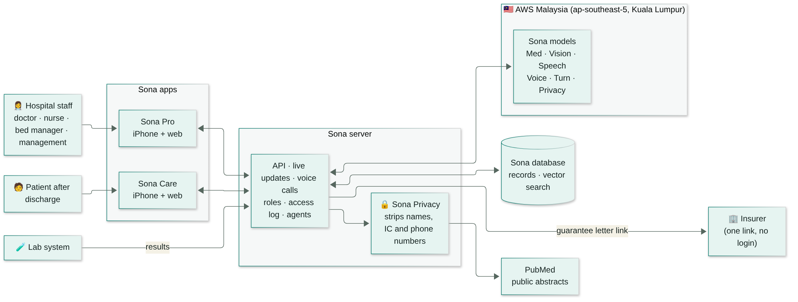
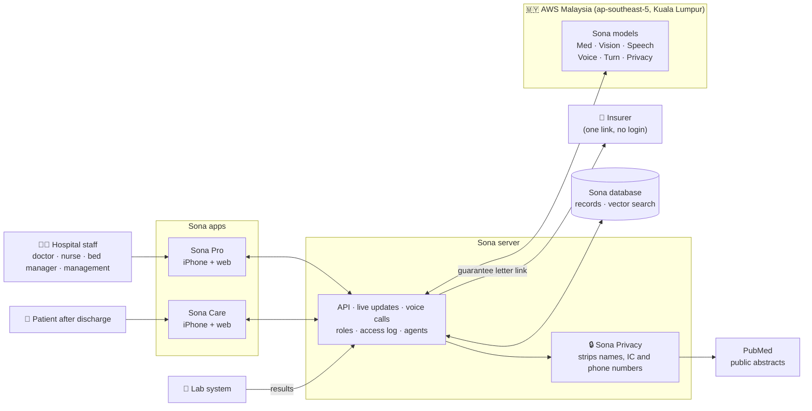

# 🩺 Sona AI

### Private, agentic AI for Malaysian hospitals.

A scribe writes the note. **Sona runs the work after it**: the insurer's guarantee letter, the ward,
the discharge, and the patient's first days at home. In Malay, English and Chinese.
On AI models we trained ourselves, running in Malaysia.

## 👉 [Judges, start here: sona-overview.zhiyuantech.workers.dev](https://sona-overview.zhiyuantech.workers.dev/)

*Every feature in video, the live system to try, and the numbers behind it.*

**Six models. All trained by us. All in Malaysia.**

> [!NOTE]
> **Want to test Sona live?** To save cost, the servers that host our AI models are temporarily in hibernate mode.
> Email **[ngchwanlii@zhiyuantech.ai](mailto:ngchwanlii@zhiyuantech.ai)** and we will wake them up for you.

| 4 screens | 6 models | ~10 s | 3.5× |
|:---:|:---:|:---:|:---:|
| Sona Pro (iPhone + web) for staff, Sona Care (iPhone + web) for patients | All trained by us, all hosted in AWS Malaysia | From a 3-minute, 4-person consultation to a full note | Fewer word errors than the next best model on Malaysian clinic speech |

---

## Our bet: every hospital group owns its AI

We are **not** trying to out-build the world's giant medical AI models, and we don't ask hospitals to send
their patients' records to one.

**We give each hospital group its own AI.** Sona's models run on a private server the hospital controls,
in its own server room or its private cloud in Malaysia. They are fine-tuned for Malaysian medicine,
Malaysian languages and that hospital's own guidelines. The hospital keeps its data, its models and its
compliance. We bring the models, the apps, and the training that keeps improving them.

That is how a Malaysian hospital uses AI **and** stays on the right side of PDPA 2024, where a breach
means mandatory notice and fines of up to RM1 million.

## The problem: one patient, one week, three breaks

Amelia is our synthetic demo patient. Her week breaks in three places:

| 1 · Clinic | 2 · Admission | 3 · Home |
|---|---|---|
| **2 hours** at the desk for every hour with patients. Her doctor writes notes instead of looking at her. Sinsky et al., Ann Intern Med 2016 | **67%** of private specialists have seen a guarantee letter revoked or denied. Her letter is denied after admission. CodeBlue survey of 855 specialists, Oct 2025 | **1 in 5** patients is harmed in the weeks after discharge. On day 2 at home she gets worse, and nobody knows. Forster et al., Ann Intern Med 2003 |

**Why now:** MediAsas goes nationwide in January 2027 with a fixed price per diagnosis, so every extra
bed-day and every wrong code becomes the hospital's loss. And Malaysia is putting RM1 billion into
electronic records across about 150 hospitals: hospitals are going digital now.

## What Sona does

| | Feature | What it does |
|---|---|---|
| 🎙 | **Ambient scribe** | Listens to the consultation, tells up to 8 voices apart, keeps Malay and Chinese as spoken, and drafts a colour-coded note in about 10 seconds. |
| 📞 | **Voice, speech to speech** | Patients talk to Sona in Malay, English or Chinese. Sona answers out loud from her own record, in a Malaysian voice we trained. Replies start in 1.5 to 2.25 s. |
| 🏠 | **Follows the patient home** | Discharge reaches her phone within a second. A red flag on day 2 gets the 999 line and becomes a task for her care team. |
| 📄 | **Guarantee letters and appeals** | Drafts the insurer's letter from the note, ties every code to a sentence, checks the insurer's rules before sending, and writes the appeal if it is denied. |
| 🩻 | **Chest X-ray** | Sona Vision drafts a read in about 4 seconds, marks the finding, and opens similar films from the hospital beside the answer. |
| 📚 | **Evidence with sources** | Answers clinical questions from PubMed and the hospital's own guidelines, with numbered citations, applied to the patient in the visit. |
| 🛏 | **Hospital operations** | Ranks patients by need, shows what holds every bed and who owns each blocker, writes the huddle brief, and raises critical lab results the moment they land. |
| 💊 | **Safety checks** | Checks a prescription before it is placed and stops a wrong dose. Scans a handwritten note into the record. |
| 📱 | **Sona Care for patients** | Her plan, medicines and warning signs in plain words, in her language. Dose reminders, a medicine-box photo check, booking, and a health summary she can take to another hospital. |

Every AI output is a **draft until a person approves it**. Nothing goes to an insurer or a patient without staff.

## Architecture

👆 Tap the diagram to open it full size.

Interactive version (zoom and pan)

Two iPhone apps and two web portals talk to one Sona server. The insurer gets one link by email and
needs no login. The lab system posts results straight in.

**Stack:** Bun + Turborepo · Expo (React Native) for iPhone · Hono + oRPC API on Cloudflare Workers ·
Postgres with vector search · Better-Auth · models served on AWS SageMaker in Malaysia.

## Private by design

**Every model that reads patient records runs in Malaysia. Patient records never leave Malaysia.**

- 🇲🇾 **Models in Malaysia.** All six Sona models run in AWS Malaysia (Kuala Lumpur), on servers we control. In a hospital, they run on the hospital's own servers.
- 🔒 **Names stripped first.** Sona Privacy removes names, IC numbers and phone numbers before anything is saved for training, saved from a scan, or searched outside (like PubMed).
- 🎙 **Audio not kept.** Consultation audio is transcribed in memory and not stored. The note and transcript stay in the record.
- ✅ **A person approves.** Every AI output is a draft until staff approve it.
- 👥 **Roles and access log.** Doctors, nurses, bed managers and management each see what their role needs. Every access is logged.
- 🚨 **Safety without AI.** If a model is down, safety still runs on rules: red-flag words always get the 999 line and a care-team task.

## Our own AI models

Sona is not a wrapper around someone else's chatbot. We fine-tuned, hosted and measured every model,
and we only ship a model when it beats the alternatives on our own tests in English, Malay and Chinese.

| Model | What it does | Measured |
|---|---|---|
| **Sona Med** | The reasoning: notes, letters, appeals, evidence answers, replies to patients, discharge plans. Built on Gemma 4 26B. | Our best 8B model scored 8 to 16 points lower on medical exams, so Sona uses the 26B. |
| **Sona Speech** | Hears medical Manglish: Malay, English and Chinese mixed in one sentence. Built on Qwen3-ASR 1.7B. | 4.1% words wrong on clinic speech; 30 of 31 drug names right |
| **Sona Voice** | Speaks Sona's replies in a Malaysian nurse's voice, trained on 4.35 hours of her speech. Built on VoxCPM2. | Reply starts 1.5 to 2.25 s after the patient stops |
| **Sona Vision** | Reads chest X-rays, handwritten notes, documents and medicine boxes. Built on MedGemma 1.5 4B. | X-ray read in about 4 s |
| **Sona Turn** | Knows when the speaker has finished, so Sona replies at the right moment in a voice call. Built on Smart Turn v3.2. | — |
| **Sona Privacy** | Strips names, IC numbers and phone numbers. Built on OpenMed PII mClinicalE5. | — |

We also trained models we did **not** ship because they lost on our tests: a one-model voice call
(worse medical answers) and two search fine-tunes (both less accurate).

🤗 **Model weights:** [huggingface.co/zhiyuantechnology](https://huggingface.co/zhiyuantechnology)

## Benchmarks: Malaysian clinic speech

Sona Speech against the strongest speech models a Malaysian hospital could use today, including Malaysia's own ILMU.
Same scoring for every model; lower is better.

| Model | 444 clinic clips words wrong | Drug names | 15 real phone recordings words wrong | Drug names |
|---|:---:|:---:|:---:|:---:|
| **Sona Speech (ours)** | **4.1%** | **30/31** | **10.0%** | **10/10** |
| Open base model (before our training) | 14.4% | 20/31 | 21.3% | 8/10 |
| Whisper large-v3 (OpenAI) | 15.4% | 22/31 | 54.0% | 5/10 |
| ILMU ASR v4.2 (YTL, Malaysia) | 16.5% | 20/31 | 24.6% | 6/10 |

**3.5× fewer word errors than the next best model on clinic speech, and every drug name but one.**

Measured 9 Oct 2026. The 444 clips are our own synthetic consultations in mixed Malay, English and Mandarin,
voiced with voices never used in training. The 15 phone recordings are real, from one speaker.

## Where Sona sits

| Product | Writes the note | Runs the work after (letter, ward, follow-up) | Where models run |
|---|:---:|:---:|:---:|
| **Sona** | ✅ | ✅ | Malaysia, on the hospital's own AI |
| Qmed Scribe | ✅ | Not seen on its public pages | On-premise option |
| Heidi | ✅ | Not seen on its public pages | Abroad or not shown |
| Global scribes | ✅ | Not seen on their public pages | US and EU |

Placed from each company's public pages, 8 Oct 2026.

## Business model

Doctors get the scribe free. **The hospital pays for what saves it money.**

- **Platform:** about RM1,800 per bed a year
- **Usage:** RM20 per guarantee letter, RM30 per patient followed home
- **Optional:** 10% of recovered claims

For one 300-bed hospital, freed beds alone return about **5.9×** what Sona costs (scenario numbers; the pilot measures them).
Prices are a proposal. Path: department, then hospital, then hospital group, then ASEAN.

## Next: one department, eight weeks

Our goal by the November final is one department in shadow mode: staff approve every output, then go
live in one department, measuring note time, letter turnaround, discharge wait and patients reached at
home. **If you know that hospital, talk to us.**

## Team · Zhiyuan Technology

Two founders. Both write the code. Over 1,300 commits since the first one on 22 Sep 2026.

- **Jay Ng**, Founder & CEO. Builds Sona's apps, servers and models. Before: Software Engineer, TreeRing, Silicon Valley.
- **Wilfred Foo Thien Hau**, Co-founder & CMO. Software engineer, co-builds Sona.

📧 [ngchwanlii@zhiyuantech.ai](mailto:ngchwanlii@zhiyuantech.ai)

**Built in Malaysia. Trained on Malaysia. Runs in Malaysia.**

MAIC 2026 · Track T2 · AI for Healthcare & Medical

