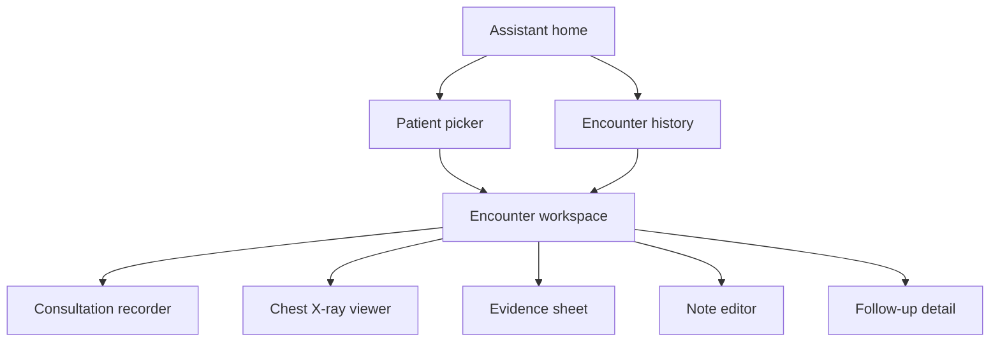

# Sona AI — iPhone UI specification

Status: design specification for review, 2026-09-22. Companion to the [PRD](prd.md), [demo storyboard](demo-storyboard.md), [design direction](design-direction.md), and [delivery plan](delivery-plan.md). No application code or backend deployment is included in this deliverable.

## 1. Product interaction decisions

- One conversational workspace is the primary interface. Automatically route requests to the appropriate clinical capability and show a short activity label. Manual specialist selection is deferred.
- Keep patient identity visible throughout an encounter. Each request and result belongs to an explicit patient and encounter; model output cannot change that identity.
- Support all seven accepted capabilities: briefing, ambient scribe, clinical reasoning, chest X-ray analysis, medication review, autonomous prescribing simulation, and follow-up coordination.
- English is the default interface and clinical-output language. Preserve the original English/Malay/Mandarin transcript separately from its English interpretation.
- The prototype uses synthetic patients. Prescribing can automatically create a simulated prescription after the specified checks, without a clinician-approval button. It does not issue a real prescription or transmit to a pharmacy.
- Start with an iPhone portrait composition. Exact demonstration model/iOS version remains unknown; layout must adapt to available space and text size instead of assuming the PNG dimensions.

## 2. Appearance and material

### Reference hierarchy

1. Monogram determines the primary liquid-glass material, conversational composition, floating controls and motion continuity.
2. The user's PNGs determine the pale grey canvas, charcoal typography, generous idle-state space and slight ambient colour. Replace pink with blue.
3. Arc Search contributes selected generation-progress, source-to-summary and voice-focus effects. Its saturated palette does not become the default screen background.

Liquid glass is a defining material, not an isolated decorative badge. Use it on the composer, voice control surround, patient-context capsule, menu controls, progress capsule, source chips and floating panels. Preserve legibility inside information-heavy cards with a more opaque surface.

### Initial design tokens

These are proposed implementation values, not extracted Figma tokens. Adjust after rendering on the target iPhone; preserve the neutral-grey/subtle-blue relationship.

| Token | Initial value | Use |
| --- | --- | --- |
| Canvas | `#E5E6E8` | Dominant pale grey background |
| Clinical surface | `#F7F8FA` | Readable note, medication and findings interiors |
| Main text | `#1D1F23` | Body, titles and primary icons |
| Secondary text | `#555C66` | Supporting text; never essential data at very low opacity |
| Accent | `#245BCC` | Actions, selected state and restrained emphasis |
| Ambient blue | `#C9DFFA` fading to transparent | Slight lower-canvas wash and orb light |
| Glass edge | White highlight over a subtle neutral separator | Thin perimeter and depth; not a clinical-status colour |
| Voice core | `#282C33` | Charcoal circular voice control with white waveform |
| Attention / blocked | Platform semantic warning/error colours plus text/icon | Status meaning; independent of brand blue |

- Use the iOS system typeface. Proposed default roles: idle greeting 32 pt regular/medium, section title 22 pt semibold, card title 17 pt semibold, body 17 pt regular, supporting text 15 pt, metadata 13 pt. Scale with Dynamic Type; allow wrapping.
- Use 4/8/12/16/20/24/32 pt spacing increments. Start with 20 pt horizontal workspace insets, 16 pt card padding and 12 pt section gaps.
- Card corners start at 24 pt; compact panels at 20 pt; input/context pills use capsule geometry. Choose continuous corners where supported.
- Interactive targets are at least 44 × 44 pt, including source buttons. Visible icons can remain smaller.
- Start the composer at 56 pt high and allow multiline growth to a measured cap; beyond it, scroll the input. Keep the separate voice button aligned with its bottom edge.
- No rigid greeting/orb height at accessibility sizes: reduce or remove the decorative hero so the composer remains accessible.
- Use low-contrast dotted texture only around the idle orb. It fades away once a patient response occupies the canvas.
- Brand symbol is unresolved; use an original neutral working mark. Do not copy Oria's flower mark, upgrade offer or generic capabilities.

### Native glass and fallback

Use `expo-glass-effect` for native material when supported. Expo documents `GlassView` on iOS 26+ and a regular-view fallback elsewhere. The application must provide a styled frosted/opaque fallback rather than accept an unstyled view. Respect reduced transparency and contrast preferences. [Expo GlassEffect](https://docs.expo.dev/versions/latest/sdk/glass-effect/)

Native glass has a documented opacity-zero rendering issue. Use its supported material transition mechanism when animating the effect; do not blindly apply a shared fade wrapper to every glass subtree. Animate content separately where needed. Confirm APIs against the installed Expo version before implementation.

Skia renders the ambient pulse/light field, not the whole interface. Keep text, selection, accessibility and clinical interaction in native views. No gradient, blur or decorative shader is applied to X-ray pixels.

## 3. Navigation and surfaces

Use one main native stack and focused presentations. There is no permanent seven-tab assistant bar or mandatory assistant picker.

| ID | Surface | Presentation | Return behaviour |
| --- | --- | --- | --- |
| S01 | Assistant home | Root workspace, no active encounter | Stay at root |
| S02 | Patient picker / patient detail | Native sheet with expandable detail | Return with selected patient; resolve active work before a switch |
| S03 | Encounter workspace | Main stack destination, reused for all result modes | Back to home/patient list without discarding encounter state |
| S04 | Consultation recorder | Focused full-screen recording view | Minimize into persistent recording capsule; Stop ends recording |
| S05 | Source / evidence detail | Native sheet | Preserve exact response reading position |
| S06 | Chest X-ray viewer | Full-screen viewer | Restore source preview and findings position |
| S07 | Clinical note editor | Native stack detail | Keep draft; resolve unsaved changes before discard |
| S08 | Task detail / follow-up list | Native detail or sheet, depending on content length | Preserve task changes and return to encounter |
| S09 | Encounter history / minimal settings | Native list reached from menu | Return to prior workspace |

The existing scaffold has drawer/tab routes. Treat this as a proposed replacement information architecture during UI implementation, preserving unrelated setup. Route filenames will follow the final stack structure; this document does not change routes.



Use native stack transitions for navigation. Prefer native Expo UI controls/sheets for focused forms and menus; use a virtualized native list for long histories/transcripts. Clinical result modes below are compositions within S03, not separate applications.

## 4. Screen definitions

### S01 — Assistant home

**Purpose:** make the first clinical action obvious without requiring the user to understand the assistant architecture.

Top to bottom: compact working-brand title and menu; open neutral canvas; small blue glass-like orb and dotted halo; greeting “How can I help today?”; a clear “Choose a patient” action; optional task-language prompt suggestions; floating composer and voice control.

```text
┌─────────────────────────────────┐
│ System status                   │
│ Sona AI                    Menu │
│                                 │
│           blue orb              │
│     How can I help today?        │
│                                 │
│        Choose a patient         │
│                                 │
│ [ +  Ask about a patient… ] [◉]  │
│          home indicator         │
└─────────────────────────────────┘
```

Task suggestions such as “Brief my next patient” prefill or submit an ordinary request; they are not a manual specialist picker. If a patient-specific request has no patient context, retain the request while opening S02. Never select a patient by inference from vague wording such as “the previous one”.

Tapping the voice control enters short voice input; starting an ambient consultation is a distinct action after patient selection. Attaching an image without a patient preserves the attachment while requesting context. Permission denial leaves text entry available.

**Done when:** a new user can select a synthetic patient and reach a briefing without choosing a model or specialist, and can still operate the screen with large text/reduced motion.

### S02 — Patient picker and context

Search field, synthetic-patient indication, and patient rows showing name, stable identifier and enough distinguishing context to prevent selection ambiguity. No invented queue urgency or risk score. Search filters the available fixture list in the UI phase.

Selecting a row opens a compact detail with medical, family and social history, allergies, medications and dated results. “Open encounter” establishes the selected context and returns to S03. Dates and units remain explicit. “Not recorded” is a data state, not a reassuring clinical conclusion.

An active recording blocks immediate patient switching: offer “Return to recording” or “Stop and switch”. An unsaved draft offers “Keep draft and switch” or “Stay”. Do not put a destructive default first. Cancelled or delayed tool results from the prior encounter never appear under the new patient.

**States:** list, searching, no match, no fixtures, detail, switching with active work.

### S03 — Encounter workspace shell

Persistent compact header: back/menu, selected patient identity and encounter label. A subtle “Synthetic patient” indicator establishes demo context. The scrollable body holds requests and structured result sections. The fixed-bottom glass composer accounts for the home indicator, keyboard and expanded text height.

```text
┌─────────────────────────────────┐
│ Back   Patient • Encounter  Menu│
│ Synthetic patient               │
│                                 │
│ What changed since last visit?  │
│ [ Reviewing patient history… ]  │
│                                 │
│ Summary                  Source │
│ ┌─────────────────────────────┐ │
│ │ Relevant changes            │ │
│ └─────────────────────────────┘ │
│ Timeline                        │
│ ┌─────────────────────────────┐ │
│ │ Dated events / source links │ │
│ └─────────────────────────────┘ │
│ [ +  Ask a follow-up…     ] [◉] │
└─────────────────────────────────┘
```

The source record, interpreted result and available action must be visually distinguishable. The AI may choose which permitted sections to show, but cannot hide patient context, change status meanings or remove required unknown/blocked notices.

Suggested next actions are few and contextual: “Start consultation”, “View source”, “Add history”, “Review note”. They invoke defined handlers, not arbitrary model-generated links or executable code.

When the clinician scrolls up, stop automatic following and show “New response below”. Returning to the bottom re-enables following. Opening/closing a focused view restores the reading position. A new request may cancel or supersede a read-only generation; it must not erase completed results or user edits.

**Global states:** idle, working, partial, complete, needs input, cancelled, failed and superseded. Use useful labels such as “Reading patient history” rather than exposing model names or raw function identifiers.

### S03-A — Patient briefing and timeline

Order: concise summary; “Changes since last visit”; dated timeline; relevant medications/allergies; missing context. Hide genuinely irrelevant optional sections, not clinically relevant unknown data. A chronological list remains available even if a compact visual timeline is used.

Each factual claim links to a dated source or transcript segment. Source taps open S05. Numerical trends include units and dates; no smoothed chart suggesting measurements between actual observations. Family/social history is accessible through a context expansion.

**Actions:** start consultation, open source, add/correct history, ask follow-up. Changes to facts increment the patient/encounter context version and mark dependent older analyses as based on previous information.

### S04 — Consultation recorder and transcript

Top: patient identity and close/minimize action. Centre: explicit recording/paused state, elapsed time, waveform and live transcript. Bottom: pause/resume and a clearly labelled Stop control. Close minimizes an active recording; it does not silently stop or imply recording ended.

Use actual audio levels for a live waveform; fixture animation is labelled in UI prototype mode. Mark interim transcript segments until finalized. Speaker identities begin as “Speaker 1/2” until assigned; do not infer clinician/patient identity solely from diarization.

“Original” and “English interpretation” are text-view controls. Tapping a finalized segment allows text or speaker correction. Preserve the original captured segment and correction provenance. A transcript correction marks derived notes/reasoning as needing refresh; refreshing must not overwrite manual note edits.

Stop returns a transcript-ready state and a “Create draft note” action. If parts failed, retain completed segments and identify the affected portion. Do not generate missing speech to make a note look complete.

**States:** microphone permission, ready, recording, paused, interrupted, stopped/processing, partial transcript, editable transcript, failed recording. In the UI phase, simulate these states without implying a real STT connection.

### S03-B — Clinical reasoning

Order: context used; possible explanations; supporting/conflicting evidence; questions/missing observations; references. Avoid probability bars or rank labels that imply calibration. Use “Possibilities to consider” rather than “Confirmed diagnosis”.

Each possibility card expands to show its evidence and gaps. “Add history” opens a small native form with category, fact, source and date. On submit, show the recorded fact immediately and request an updated analysis. Mark which sections changed and retain the previous result for inspection.

The clinician's recorded assessment is a separate editable field. A hypothetical indication used by the prescribing simulation must be explicitly identified as a simulation assumption, not entered as a clinician-confirmed diagnosis.

**States:** gathering context, partial, complete/preliminary, needs information, no usable evidence, updated, based on older context. An unavailable source link does not make a citation appear verified.

### S05 — Source and evidence detail

Show source type (patient record, original transcript, clinical reference), title/date, exact supporting passage, and a return action. Clearly distinguish supplied facts from retrieved clinical guidance. Reference metadata includes version/publication date and available link; never synthesize an author or URL.

For transcript sources, show the segment and speaker; jump to audio only when a genuine timestamp/audio mapping exists. Patient sources open inside the same encounter context. Long evidence content scrolls and supports text selection; dismiss restores the prior card position.

**States:** available, loading, not found, unavailable, superseded source version.

### S06 and S03-C — Chest X-ray viewer and findings

Attach a supported image and keep an unfiltered original. The viewer uses a neutral dark viewing surface, native close control, pinch/pan, reset zoom and image metadata. Contrast/background controls must not alter the stored original; advanced imaging controls are outside the initial scope.

On “Analyse X-ray”, return to S03 with the source preview above preliminary findings. Adapt Arc's source-to-summary transition without resizing the image content under an active inspection gesture. Keep observation, contextual interpretation and limitations separate.

No diagnostic heatmap, region box or animated scanning claim is shown unless a real supported output exists. Progress text describes actual analysis; a decorative sweep, if used outside the pixels, cannot imply detected pathology.

**States:** choosing file, attaching, ready, analysing, partial findings, complete/preliminary, unreadable input, unsupported format/category, failed request. Preserve the attachment when retrying an analysis.

### S03-D — Medication review

Order: current medication list; proposed medication; resolved ingredient/formulation; interaction results; coverage notice. Show source-backed warning meaning without inventing severity. Colour supports, but does not replace, text and icons.

An ambiguous drug name opens an ingredient-confirmation form; unknown ingredient/coverage produces “Unable to complete this check”. A completed lookup with no match is labelled within the named source's coverage and never as “Safe”. Allergy findings remain distinct from drug–drug interactions.

**Actions:** correct medication, inspect source, recheck after context change, request prescribing simulation. A change to medication data invalidates the old check for subsequent prescription creation.

### S03-E — Autonomous prescribing simulation

This is a real planned product flow inside the synthetic demo, not a clinician-approval workflow renamed as autonomy.

Order: indication and its provenance; regimen being evaluated; required-input/check summary; simulated prescription result or blocking explanation. A completed regimen includes medication/formulation, dose/unit, route, frequency, duration and source references. Do not populate medical values from decorative fixtures presented as real clinical guidance.

The sequence is `requested → checking → blocked OR creating simulation → simulated prescription created`. Creation is driven by a complete validated backend outcome, never the model's choice of UI component or a stream-completion animation. The UI phase simulates these events explicitly.

- No “Approve prescription” button is required for successful simulated creation.
- A blocked state says what is missing or failed and offers the relevant correction/source action. There is no “Ignore and issue” shortcut.
- A created state reads “Simulated prescription created” and retains the synthetic-patient label. No actual prescribing signature, real prescriber identity or pharmacy-send action is fabricated.
- Allow later inspection and amendment. An amendment creates a new version and reruns relevant checks; it does not mutate an issued snapshot silently.
- Distinguish prescription creation from drug-check success and from clinical validity. Do not use “Clinically verified” for model/schema checks.
- Cancellation before creation stops the requested operation if possible. If creation already completed, show the actual receipt; never claim cancellation revoked an existing result.
- A changed patient/context version prevents an older in-flight result from being accepted as current. Retry uses a stable operation identity to prevent duplicate prescriptions.

**Required states:** checking, missing fact, unknown interaction coverage, ambiguous medication, unsupported regimen, failed prerequisite, cancelled, creation failed, created, amended/superseded. Detailed audit/model identifiers are available in an inspection view, not scattered through the normal clinical workflow.

### S07 — Note editor

Native detail screen with patient/encounter header, draft/reviewed status and structured sections. Present source-linked text with section-level editing, rather than placing all content into one unstructured chat bubble. Keep AI suggestions, clinician edits and simulated prescribing results labelled by provenance.

“Save draft” saves without implying review. “Mark reviewed” is a separate clinician action for the note, not a gate on simulated prescribing. A regenerated suggestion appears separately for comparison before replacing clinician-edited text.

Keyboard tracks the focused input without hiding Save controls. Back navigation keeps drafts or offers explicit discard. A failed save preserves text and offers retry. UI fixtures must distinguish local simulated save from later backend persistence.

### S08 — Follow-up task proposal and detail

Show task text, owner, due date and originating plan/source. Unknown owner/date is editable and never silently invented. Use native pickers/form controls for finite choices. The proposal has a “Create task” action and a clear resulting receipt.

Repeated presses while saving are disabled; retried requests preserve operation identity. Returning to a created task shows persisted status and current values. This does not book an external appointment or send a message to staff.

**States:** proposal, needs details, editing, saving, created, save failed, completed. For the demo, a narrow task list is enough; a hospital-wide operations dashboard is not required.

### S09 — History and minimal settings

Provide encounter history with patient/date identification and resume action. Minimal settings include text/voice preferences and clear demo-mode information. Do not build an upgrade/paywall, staff administration suite or assistant marketplace for this phase.

Keep authentication scaffold behaviour intact until implementation establishes the demo access path. No new auth system is specified here. Demo reset lives in an explicitly labelled fixture/development control, not as an ordinary clinical action.

## 5. Dynamic UI and action contract

Use a finite, versioned component catalogue. The assistant selects supported components and supplies structured content; it does not generate executable React Native code. The renderer validates component names, props and permitted actions before rendering. Validation establishes structural correctness, not clinical correctness.

| Component family | Required content | Permitted interaction |
| --- | --- | --- |
| Patient briefing / timeline | Patient and encounter identity, dated facts, source references | Open source, expand history |
| Transcript / note | Original utterances, speaker labels, draft text, revision | Correct transcript, edit note |
| Diagnostic possibilities | Supporting and conflicting findings, missing information, sources | Inspect evidence, supply missing facts |
| X-ray finding | Image identity, findings, limitations, provenance | Open original image, inspect source |
| Medication review | Normalised ingredients, evaluated scope, evidence, coverage status | Resolve ambiguity, inspect interaction |
| Prescription status / receipt | Operation ID, encounter version, authoritative status, checks or block reasons | Supply missing facts, inspect receipt, request amendment |
| Follow-up task | Proposed text, owner/date or missing fields, operation status | Edit, create, open persisted task |

Keep three concerns separate: clinical result data, presentation specification, and authoritative action state. A generated card cannot declare that a prescription or task has been created. Only the matching completed action result can establish that state.

Every request and result carries patient ID, encounter ID, request ID and relevant context revision. Actions additionally carry an operation ID for deduplication. The app provides these bindings; the model cannot switch the active patient by emitting a different identifier.

The application needs the following conceptual events, independent of the eventual transport or library API:

1. Request accepted: preserve the user message and show a cancellable progress surface.
2. Work started: display a truthful short activity label when the corresponding operation begins.
3. Section available: validate and reveal a stable card when its required content is available.
4. Section updated: update that card by stable ID without remounting the whole response.
5. Completed, failed or cancelled: settle progress and preserve useful completed sections.

Choose snapshot versus patch transport during integration. Buffer incomplete structured payloads; do not render unfinished JSON or infer a completed clinical result from partial tokens. Narrative text can stream independently where appropriate. Medication checks and prescription receipts require complete validated payloads.

Reject stale patient/context results. Deduplicate repeated events and preserve ordering within a request. A failed component specification falls back to a readable presentation of the same validated result data, with permitted actions still controlled by the app. Never substitute invented successful content to make a response look complete.

User edits take precedence over incoming suggestions. Edited fields retain their revision; new AI content becomes an explicit suggestion or a new version. Cancelling visual generation does not prove an external operation was cancelled: reconcile its authoritative status before offering a retry. In this prototype, prescription issuance remains entirely inside the synthetic simulation.

Use the documented [json-render React Native integration](https://json-render.dev/docs/api/react-native) as an implementation candidate. JEV remains optional; this specification does not depend on an experimental gateway. Fixture mode uses the same component and event contracts and is visibly identified during demonstrations.

## 6. Motion specification

Follow the [60fpsdesign inspiration and conversion workflow](design-direction.md#inspiration-and-implementation-workflow) when more references are needed. Inspect shot details and motion breakdowns, explore related variations where useful, and adapt selected `get_motion_code` SwiftUI references into React Native using the named motion/UI skills. Keep Monogram primary and Arc secondary.

These are initial tuning values, not measurements extracted from Monogram or Arc. Use the references for movement relationships and material treatment; tune on the demonstration iPhone.

| Interaction | Intended motion | Starting timing |
| --- | --- | --- |
| Button press | Small scale or material change, immediate feedback | 100–150 ms |
| Request begins | Composer settles; compact progress pill appears in the response flow | 180–220 ms |
| First response card | Short upward reveal, approximately 8 pt, into its final layout | 180–240 ms |
| Several sections arrive together | Brief stagger for newly inserted cards only | 30–40 ms between cards, capped to avoid waiting |
| Progress becomes a result | Shared container grows and settles around available content | 220–300 ms |
| Evidence condenses above summary | Source preview reduces into a persistent source header | 220–300 ms |
| Voice surface opens | Native presentation plus subtle waveform/ambient response | 200–280 ms |
| Subsequent text or values update | Stable layout; no repeated entrance animation | Immediate or a short crossfade where appropriate |

Use Reanimated for view transforms and transitions, Skia only where custom ambient drawing is justified, and native navigation for ordinary transitions. Reserve recurring pulse/waveform movement for an active operation; do not keep a large decorative idle animation consuming attention. Audio-reactive motion must use available audio levels, not imply speech detection when none exists.

Avoid an opacity-from-zero entrance on native glass or its ancestors; use supported glass transitions or animate position/size while preserving the glass material. Verify the fallback independently. Never shade, distort or animate clinical image pixels as a decorative effect.

Reduced Motion removes translation, pulse and morph effects while retaining immediate state changes. Reduced Transparency uses more opaque surfaces. Streaming must not move the user's reading position, steal focus, obscure the keyboard caret or repeatedly trigger screen-reader announcements. Announce meaningful status changes and completed sections instead of every token.

## 7. UI fixture scenarios

Fixtures establish interaction behaviour only. Clinical accuracy and model evaluation remain separate backend/evaluation work.

| Scenario | Visible result required |
| --- | --- |
| Full synthetic encounter | All seven capabilities connect through one patient workspace; provenance remains reachable |
| English recording | Recording state, labelled speakers, editable transcript and English draft note |
| Bounded Manglish sample | Original mixed-language transcript alongside English clinical output; uncertain text can be corrected |
| Missing history or ambiguous medicine | Unknown values are explicit; the app requests the specific missing information |
| Supported teaching chest X-ray | Original image opens; findings and limitations remain linked to that image |
| Unsupported or failed image analysis | Image remains accessible with an honest unavailable result |
| Completed simulated prescription | Required checks complete, then an automatic simulated receipt appears without an approval step |
| Blocked simulated prescription | Concrete block reasons appear; no issued receipt or bypass action |
| Patient switch during streaming | Late results cannot appear in the newly selected patient's encounter |
| Edit while a response streams | Local edits survive; incoming suggestions cannot overwrite them |
| Disconnect, retry or duplicate event | Completed cards persist; a retry cannot duplicate tasks or prescriptions |
| Cancel during action execution | UI reconciles actual operation status rather than assuming cancellation succeeded |
| Large text, reduced motion/transparency | Content and actions remain readable, reachable and correctly ordered |

Do not populate prescription fixtures with arbitrary dosing presented as validated medicine. The bounded regimen and its evidence are a separate required input before the prescribing demonstration is clinically meaningful.

## 8. UI implementation order

“First implementation slice” means a small, connected portion of the future UI, not the entire application and not an instruction to start coding now. The current deliverable remains planning; the user has requested this workflow update and explanation before implementation.

Implement after review of this specification, following the user's UI-first sequence:

1. **First usable slice:** pale-grey/blue home, glass composer and patient capsule, patient selection, encounter workspace, streamed fixture briefing. Establish the design tokens and accessible glass fallback here.
2. **Complete result catalogue:** timeline, diagnostic possibilities, medication evidence, X-ray summary/viewer, prescription checks/blocked/receipt states and follow-up proposals. Connect them with typed fixture events and source views.
3. **Focused workflows:** recorder presentation and fixture playback, transcript corrections, note editing, task details and encounter history. Clearly identify simulated audio/transcription until capture/inference is connected.
4. **Interaction completion:** cancellation, retry, patient/context isolation, edit preservation, keyboard behaviour, large text and reduced effects. Polish the selected Monogram/Arc motion relationships on a physical device.
5. **UI review milestone:** rehearse the complete fixture encounter and failure cases. Only after this UI milestone is accepted, connect backend services and model inference in the delivery plan.

The existing drawer/tab scaffold can be adapted during implementation; no new navigation dependency or wholesale auth replacement is required by this specification. Confirm actual installed APIs before choosing native controls or glass packages.

### What the first slice delivers

The reviewable journey is: **open the home screen → choose a synthetic patient → request a briefing → see progress resolve into interactive briefing cards → inspect a source**. It establishes the pale-grey/subtle-blue theme, glass composer and patient capsule, keyboard/safe-area behaviour, basic navigation and the first reusable response components.

Use local fixtures to simulate response events through the proposed component contract. The briefing shows dated patient facts and medical/family/social history from those fixtures. Include loading, empty, failure and retry presentations, with stable patient identity and reduced-motion/transparency behaviour. Source inspection can be a minimal sheet in this slice.

The purpose is to assess the actual iPhone experience—materials, readability, motion and prompt-to-card interaction—before repeating those patterns across all seven capabilities. This slice does not connect Baseten, train models, deliver real transcription or perform clinical inference. Those belong to the later agreed backend phase. A fixture response demonstrates UI behaviour, not model capability.

## 9. Completion criteria and remaining inputs

The UI milestone is complete when every specified surface and fixture scenario is reachable, all seven capabilities form one coherent encounter, long clinical content remains legible, and the iPhone walkthrough works without unexplained dead ends. Every visible control must either perform its fixture action or clearly explain its unavailable state. No screen should imply live inference, persisted backend data or real prescribing when running fixtures.

Verify on the selected physical iPhone in a release build, including streaming while scrolling and editing. Record measured responsiveness and frame behaviour before claiming performance. Backend acceptance additionally requires real action-state reconciliation, appropriate evidence sources, and separate model/clinical evaluation; attractive fixture screens do not satisfy those requirements.

Still needed before dependent integration or final device verification: exact iPhone/iOS, remaining deadline and daily hours, permitted teaching image assets, medication/regimen evidence access, and the bounded synthetic prescribing scenario. These do not prevent building the initial UI slice. Exact Figma tokens remain unavailable; the supplied screenshots and proposed blue adaptation provide the working design direction.
